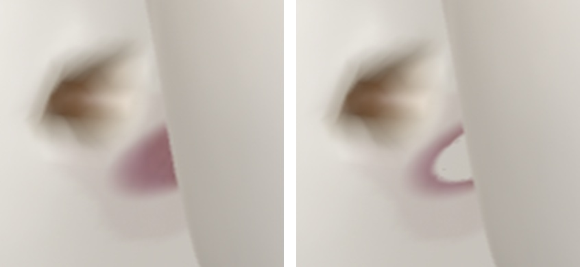

# Kefka a čistenie medzi 36 a 37

Kefka vstupuje z lícnej strany po priamke určenej zo skutočných usadených plôch dolných zubov. Geometria zubov sa kvôli nástroju neposúva. Dáta koridoru a povrchových vrstiev sú v [site.json](../public/story-assets/site.json), výpočet a pôvod anatomických podkladov v [PROXIMAL_SITE.md](PROXIMAL_SITE.md) a [atribúcii](../public/story-assets/credits.txt).

| Rozmer v tejto ilustrácii | Hodnota |
|---|---:|
| Celý zmeraný lícno-jazykový koridor | 14,345 mm |
| Predvedený maximálny posun špičky od vstupu | 11,7 mm |
| Oceľový drôt / vonkajší nezaťažený priemer vlákien | 0,18 / 1,20 mm |
| Dĺžka osadenej časti / voľná špička pred vláknami | 8,0 / 0,45 mm |
| Špička až predná hrana objímky / priemer objímky | 13,1 / 1,6 mm |
| Dĺžka tvarovanej fialovej rukoväti | 18 mm |

Zmeraný koridor je dlhší než predvedený pracovný pohyb. Na konci tohto pohybu je predná hrana objímky ešte 1,4 mm pred začiatkom zmeranej osi. Vlákna zostávajú lepšie viditeľné pri bočnej stene zuba. Zmena predvedenej dráhy mení aj výpočet odstránenej vrstvy; čistenie nesmie predbehnúť doteraz dosiahnutú polohu vlákien.

Na drôte sú dva stočené kovové pramene. Protiľahlé páry tenkých nepravidelne dlhých nylonových vlákien vytvárajú pozdĺžne mierne zúženú hlavu. Renderuje sa 344 vlákien na počítači alebo 208 v kompaktnej verzii; každé má dva krátke segmenty v jedinom instancovanom vykreslení. Pri stene sa skrátia v radiálnom smere a mierne sklonia pozdĺž osi podľa miestnych kontaktných rovín oboch LOD. Ide o ilustratívny ohyb, nie o simuláciu materiálových síl. Kefka sa počas ťahov nekrúti okolo osi.

Povlak kopíruje indexované trojuholníky zubov 36 a 37 s posunom 0,020–0,036 mm pozdĺž správne transformovanej normály. Jemný ružovofialový kontrast označuje demonštrovaný biofilm. Počiatočné zvýraznenie je sústredené v kontakte: do radiálnej vzdialenosti 0,55 mm má plnú intenzitu a do 0,72 mm plynule klesne na 12 %. Tento profil sa počas čistenia nemení a periférna vrstva nezmizne globálnym stlmením.

Pri každom vzorkovaní sa odstránenie vypočíta z najvzdialenejšej už dosiahnutej polohy. Závisí aj od nábehu prvej časti kužeľovito osadených vlákien. Fragment mimo polomeru vlákien alebo pred pracovným čelom sa neodstráni. Krátky spätný ťah už vyčistené miesto nezafarbí, no spätné posunutie celého príbehu obnoví príslušný skorší stav. Otvorená lézia má vlastnú výluku v nanesenej vrstve: vyčistenie nezmení jej hĺbku ani tvar.

V oboch výrezoch je tá istá kamera a rovnaké osvetlenie. Svetlá plocha vnútri označeného pásu sa odkryla po prechode vlákien; tenký obvod zostáva. Tmavšia priehlbina nad ním sa nezmenila. Výrez je zväčšený na porovnanie, nie na meranie rozmerov.

`node scripts/test-cleaning-path.mjs` kontroluje oba skutočné GLB modely, registráciu povrchu, stopku objímky, priestorový dosah, zvyškovú vrstvu a reprodukovateľnosť dopredných/spätných stavov. Voliteľný `node scripts/audit-brush-contact.mjs` vyžaduje Blender (`BLENDER_BIN` alebo Blender na PATH). Kontroluje prienik renderovaných trojuholníkov s tvrdými povrchmi 35/36/37 v 83 polohách na každý LOD a overuje aj fyzický kontakt vlákien s vystúpenou vrstvou na oboch zuboch. Je to konečný vzorkový test; samostatný spojitý certifikát v `site.json` sa týka tuhého drôtu v zmeranom koridore.

[Výsledok auditu predvedených polôh](proximal-story-review/brush-contact-audit.json): bez zaznamenaného prieniku do tvrdých povrchov. Vlákna sa dotkli zobrazených vrstiev na oboch zuboch; pevné časti nástroja sa ich nedotkli.

Kód nástroja a procedurálny vzhľad sú pôvodné pre túto prezentáciu (MIT repozitára), bez zakúpeného modelu alebo loga výrobcu. Anatomické siete a odvodené údaje si ponechávajú pôvodnú licenciu. Rozmery, odtiene a ukážkové ťahy opisujú túto konkrétnu scénu; nie sú odporúčaním veľkosti pomôcky pre jednotlivca. Mäkké tkanivá ani pacientsky stav sa nesimulujú.
