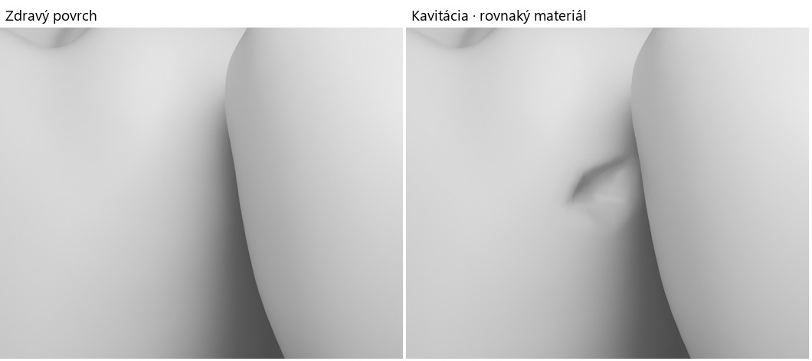

# Geometria príbehu medzi 36 a 37

[Priestor, dráha kefky a plochy povlaku](../public/story-assets/site.json) vychádzajú z naozaj umiestnených zubov 36 a 37. GLB sú v lokálnych metroch, svetová scéna v centimetroch a dĺžky nástroja v milimetroch. Posun dolného oblúka −0,48 cm je už zahrnutý vo svetových hodnotách. Zuby sa pre kefku neodsúvajú. Mierka je ilustračná, nie meranie konkrétneho pacienta.

## Kde prechádza kefka

V najužšej nájdenej oblasti sú tvrdé povrchy vzdialené približne 0,202 mm. Nie je to nulový bod dotyku. Zvolená priama os kefky leží približne **2 mm apikálne** od tejto oblasti a vedie 14,35 mm z bukálnej na lingválnu stranu vrátane voľného začiatku a konca. Kontrola hustých vzoriek oboch úrovní detailu dáva dolnú hranicu vzdialenosti osi od tvrdého povrchu **0,439 mm**. Využíva vlastnosť, že vzdialenosť od povrchu sa medzi dvoma bodmi nemôže zmeniť o viac než ich vzájomná vzdialenosť; od vzorkovaného minima sa odpočítava polovica kroku a numerická rezerva.

Drôt v tejto ilustrácii má priemer **0,18 mm**, teda radiálnu rezervu aspoň 0,349 mm. Voľný vonkajší priemer štetín je 1,2 mm; **pevná trubica tohto priemeru by neprešla**. Ich geometrický dosah zahŕňa iba časť priľahlého povlaku. Hrubá objímka zostáva na vstupnej strane; jej predná osová stanica má limit 1,429 mm od začiatku dráhy, pred prvou dvojicou protiľahlých stien. Údaje o miestnych stenách, najbližších bodoch a normálach sú uložené pri 112 vzorkách dráhy.

**Predvedený maximálny posun špičky je 11,7 mm**, kratší než celý preskúmaný koridor. Pri tejto polohe leží hrana objímky na osovej stanici −1,4 mm, ešte pred vstupom. Rovnaké skrátené rozpätie určuje aj dosah zobrazeného čistenia. Oblasť s intenzívnym počiatočným zvýraznením povlaku je sústredená pri kontaktnej dráhe; jej periféria je od začiatku slabšia a počas čistenia sa plošne nestlmí. Podrobné rozmery a kontroly sú v [opise kefky a povlaku](INTERDENTAL_BRUSH.md).

Tieto čísla nehovoria, kam možno zaviesť kefku v živých ústach: scéna neobsahuje papilu, ďasno, mäkkotkanivový odpor ani silu kontaktu. Farba nástroja nie je univerzálnym odporúčaním jeho veľkosti. [Odborné zdroje a hranice príbehu](DENTAL_STORY_SOURCES.md).

## Čo sa čistí a čo zostáva

Povlak leží na pôvodných trojuholníkoch distálnej plochy 36 a meziálnej plochy 37. Pozície, normály, UV a orientácia trojuholníkov pochádzajú zo skutočných mesh súborov. Kompaktnejší zub 37 má vlastný povrchový výrez; 36 má na oboch profiloch totožnú geometriu. Každý vrchol má vzdialenosť od konečnej dráhy, najbližšiu osovú stanicu a mäkkú okrajovú masku. Dosah štetín sa preto neodvodzuje iba z kapitoly alebo času. V každom výreze sú zasiahnuteľné aj nezasiahnuteľné oblasti. Maska lézie zabraňuje premosteniu vzniknutej dutiny pôvodným zdravým povrchom povlaku.

Hypotetická lézia je na distálnej ploche 36, 1,05 mm apikálne a 2,00 mm bukálne od najužšej oblasti. Jej stred leží približne 4,32 mm koronálne od miestneho **odhadnutého** krčkového rozhrania. Na rozdiel od dostupných plôch povlaku je 1,14 mm od osi drôtu — mimo voľného polomeru štetín 0,60 mm. Zobrazená kefka tento stred nedosiahne a nevylieči už vzniknutú dutinu.

## Skorá zmena a skutočná priehlbina

[Riedky morph 36](../public/story-assets/caries-36.json) sa viaže na pôvodné indexy schváleného dolného molára. Na začiatku sa môže zmeniť materiál skloviny, ale geometrický vplyv je nulový. Až ilustračná kavitácia posúva 39 vrcholov dovnútra. Dáta pre 113 vrcholov zahŕňajú aj normály susedných trojuholníkov a nepravidelný materiálový okraj. Iné pozície ani UV sa nemenia. Zub 46 naďalej používa zdravú geometriu.

Maximálna výsledná hĺbka je **0,641 mm**; pôdorys posunu väčšieho než 5 µm má približne **1,39 × 1,04 mm**. Kladný orientovaný objem sa v nominálnej mierke zmenší o 0,334 mm³. Preto je priehlbina čitateľná aj na jednofarebnom kontrolnom materiáli. Rozmery a sfarbenie sú autorské, nie údaje z vyšetrenia alebo meranie priebehu choroby.



Vľavo zdravý povrch, vpravo rovnaký neutrálny materiál s konečným geometrickým vplyvom. Ide o nezávislý offline Cycles render, nie snímku finálneho webového shaderu.

[Nezávislý BVH audit](proximal-story-review/morph-geometry-audit.json) kontroloval vplyvy 0, 0,25, 0,5, 0,75 a 1. Pri piatich vzorkovaných geometrických stavoch vrátane oboch krajností neboli zistené samoprieseky nesusediacich trojuholníkov, prevrátené alebo degenerované plochy ani otvorené UV švy. Pri každom stave a oboch LOD sa overilo všetkých 182 dvojíc v rovnakom oblúku a 196 protiľahlých dvojíc s už použitým otvorením 8 mm; bez prieniku. Pri overenom makropohľade bola viditeľná najhlbšia časť a všetky vzorkované stredy 27 plôch dna. Časť širšieho kriedového okraja prirodzene zakrýva zub 37 — celý okraj sa nevydáva za viditeľný z jediného uhla.

## Reprodukcia

`assets/source/proximal-story` obsahuje meranie dráhy a výber viditeľného miesta na pôvodnej sieti, vrátane spustiteľných Blender skriptov. Po prípadnej zmene podkladov treba zopakovať priestorové audity. Bežné zostavenie webu Blender nepotrebuje.

```sh
python scripts/prepare_proximal_story.py
node scripts/validate-proximal-site.mjs
node scripts/test-cleaning-path.mjs
node scripts/audit-brush-contact.mjs
blender --background --factory-startup --python scripts/render_caries_review.py -- ../geometry-review
```

Geometrický pôvod, licencia CC BY 4.0 a opis nových úprav: [kredity príbehu](../public/story-assets/credits.txt).
