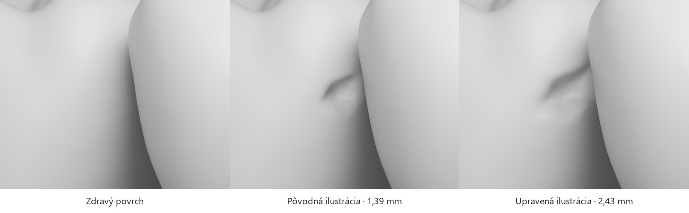

# Geometria príbehu medzi 36 a 37

[Priestor, dráha kefky a plochy povlaku](../public/story-assets/site.json) vychádzajú z naozaj umiestnených zubov 36 a 37. GLB sú v lokálnych metroch, svetová scéna v centimetroch a dĺžky nástroja v milimetroch. Posun dolného oblúka −0,48 cm je už zahrnutý vo svetových hodnotách. Zuby sa pre kefku neodsúvajú. Mierka je ilustračná, nie meranie konkrétneho pacienta.

## Kde prechádza kefka

V najužšej nájdenej oblasti sú tvrdé povrchy vzdialené približne 0,202 mm. Nie je to nulový bod dotyku. Zvolená priama os kefky leží približne **2 mm apikálne** od tejto oblasti a vedie 14,35 mm z bukálnej na lingválnu stranu vrátane voľného začiatku a konca. Kontrola hustých vzoriek oboch úrovní detailu dáva dolnú hranicu vzdialenosti osi od tvrdého povrchu **0,439 mm**. Využíva vlastnosť, že vzdialenosť od povrchu sa medzi dvoma bodmi nemôže zmeniť o viac než ich vzájomná vzdialenosť; od vzorkovaného minima sa odpočítava polovica kroku a numerická rezerva.

Drôt v tejto ilustrácii má priemer **0,18 mm**, teda radiálnu rezervu aspoň 0,349 mm. Voľný vonkajší priemer štetín je 1,2 mm; **pevná trubica tohto priemeru by neprešla**. Ich geometrický dosah zahŕňa iba časť priľahlého povlaku. Hrubá objímka zostáva na vstupnej strane; jej predná osová stanica má limit 1,429 mm od začiatku dráhy, pred prvou dvojicou protiľahlých stien. Údaje o miestnych stenách, najbližších bodoch a normálach sú uložené pri 112 vzorkách dráhy.

**Predvedený maximálny posun špičky je 11,7 mm**, kratší než celý preskúmaný koridor. Pri tejto polohe leží hrana objímky na osovej stanici −1,4 mm, ešte pred vstupom. Rovnaké skrátené rozpätie určuje aj dosah zobrazeného čistenia. Oblasť s intenzívnym počiatočným zvýraznením povlaku je sústredená pri kontaktnej dráhe; jej periféria je od začiatku slabšia a počas čistenia sa plošne nestlmí. Podrobné rozmery a kontroly sú v [opise kefky a povlaku](INTERDENTAL_BRUSH.md).

Tieto čísla nehovoria, kam možno zaviesť kefku v živých ústach: scéna neobsahuje papilu, ďasno, mäkkotkanivový odpor ani silu kontaktu. Farba nástroja nie je univerzálnym odporúčaním jeho veľkosti. [Odborné zdroje a hranice príbehu](DENTAL_STORY_SOURCES.md).

## Čo sa čistí a čo zostáva

Povlak leží na pôvodných trojuholníkoch distálnej plochy 36 a meziálnej plochy 37. Pozície, normály, UV a orientácia trojuholníkov pochádzajú zo skutočných mesh súborov. Kompaktnejší zub 37 má vlastný povrchový výrez; 36 má na oboch profiloch totožnú geometriu. Každý vrchol má vzdialenosť od konečnej dráhy, najbližšiu osovú stanicu a mäkkú okrajovú masku. Dosah štetín sa preto neodvodzuje iba z kapitoly alebo času. V každom výreze sú zasiahnuteľné aj nezasiahnuteľné oblasti. Maska lézie zabraňuje premosteniu vzniknutej dutiny pôvodným zdravým povrchom povlaku.

Hypotetická lézia je na distálnej ploche 36, 1,05 mm apikálne a 2,00 mm bukálne od najužšej oblasti. Jej stred leží približne 4,32 mm koronálne od miestneho **odhadnutého** krčkového rozhrania. Na rozdiel od dostupných plôch povlaku je 1,14 mm od osi drôtu — mimo voľného polomeru štetín 0,60 mm. Zobrazená kefka tento stred nedosiahne a nevylieči už vzniknutú dutinu.

## Skorá zmena a skutočná priehlbina

[Riedky morph 36](../public/story-assets/caries-36.json) sa viaže na pôvodné indexy dolného molára. V štádiu nekavitovanej zmeny má geometrický vplyv nulu. Pri kavitácii posúva 95 vrcholov dovnútra. 202 záznamov zahŕňa aj okolité normály a materiál okraja. Pôvodné UV a topológia sú zachované. Zub 46 používa zdravú geometriu.

Rozšírená priehlbina má **2,43 × 1,48 mm a hĺbku 0,769 mm** v ilustračnej mierke. Pôdorys je rozpätie vrcholov posunutých o viac než 5 µm v dvoch dotyčnicových smeroch. Bukolingválna šírka je 1,74-násobkom predchádzajúcej verzie. Orientovaný objem ubudol o 0,783 mm³. Pôvodný stred, polohy zubov a dráha kefky sa zhodujú s verziou `f3257d1`.



Kontrolné rendery Cycles používajú rovnaké neutrálne materiály, pohľad a svetlo. Na pravej snímke je vidieť rozšírenú bočnú stenu a nepravidelný okraj aj bez zafarbenia. Zub 37 prirodzene zakrýva časť lingválnej strany.

Počas postupného prechodu medzi zdravým a zmeneným povrchom zostávajú všetky trojuholníky dna najmenej 0,802 mm od osi drôtu. Túto dolnú hranicu dáva radiálna projekcia šiestich krajných vrcholov každého trojuholníka. Zahŕňa celú plochu pri každej hodnote geometrického vplyvu. Pre všetkých 203 trojuholníkov s aspoň jedným vrcholom posunutým o viac než 5 µm je rovnaká hranica 0,606 mm. Voľný polomer štetín je 0,600 mm. Priehlbina je pri dráhe čistenia, jej dno mimo dosahu štetín.

[Audit rozšírenej priehlbiny a kefky](proximal-reframe-review/independent-geometry.json) použil skutočné plochy 28 zubov v polohe čistenia s otvorením 8 mm. V piatich vzorkách deformácie a pri oboch úrovniach detailu našiel nula prienikov v 3 780 dvojiciach zubov. Povrch 36 sa neprevrátil ani neotvoril na UV švoch. V 83 polohách nástroja pri každej úrovni detailu neprechádzali jeho pevné časti ani štetiny cez zuby. Štetiny sa pri zasúvaní dotkli povlaku na 36 aj 37. Dolná hranica odstupu týchto vzorkovaných nástrojových plôch od dna dutiny bola 0,203 mm.

V záberoch kazu, čistenia a výsledku zostalo viditeľných 59 z 59 vzorkovaných stredov trojuholníkov dna, najhlbší vrchol aj vstupný bod dráhy. Overili sme základné polohy kamery pre obe úrovne detailu aj [šesť skutočných polôh zaznamenaných prehliadačom](proximal-reframe-review/browser-camera-inputs.json). Najmenšia zmeraná vzdialenosť kamery od tvrdého povrchu bola 11,84 mm v mobilnom zábere dutiny.

[Samostatná kontrola záverečného úsmevu](proximal-reframe-review/smile-closure.json) zahŕňa celú dráhu priblíženia horného oblúka o 5,8 mm so zrelou dutinou na 36. Na každej úrovni detailu prešlo 196 protiľahlých dvojíc bez prieniku. Pri kontrolnom posune o 6,4 mm sa pretli rezáky 21 a 31. Tieto merania opisujú výučbovú scénu.

[Pôvodný audit verzie `f3257d1`](proximal-story-review/morph-geometry-audit.json) zostáva dostupný pre porovnanie so skoršou, užšou ilustráciou.

## Reprodukcia

`assets/source/proximal-story` obsahuje meranie dráhy a výber viditeľného miesta na pôvodnej sieti, vrátane spustiteľných Blender skriptov. Po prípadnej zmene podkladov treba zopakovať priestorové audity. Bežné zostavenie webu Blender nepotrebuje.

```sh
python scripts/prepare_proximal_story.py
node scripts/validate-proximal-site.mjs
node scripts/test-cleaning-path.mjs
node scripts/audit-brush-contact.mjs
node docs/proximal-reframe-review/run-audit.mjs
blender --background --factory-startup --python-exit-code 1 --python docs/proximal-reframe-review/smile-closure.py
blender --background --factory-startup --python scripts/render_caries_review.py -- ../geometry-review
```

Geometrický pôvod, licencia CC BY 4.0 a opis nových úprav: [kredity príbehu](../public/story-assets/credits.txt).
