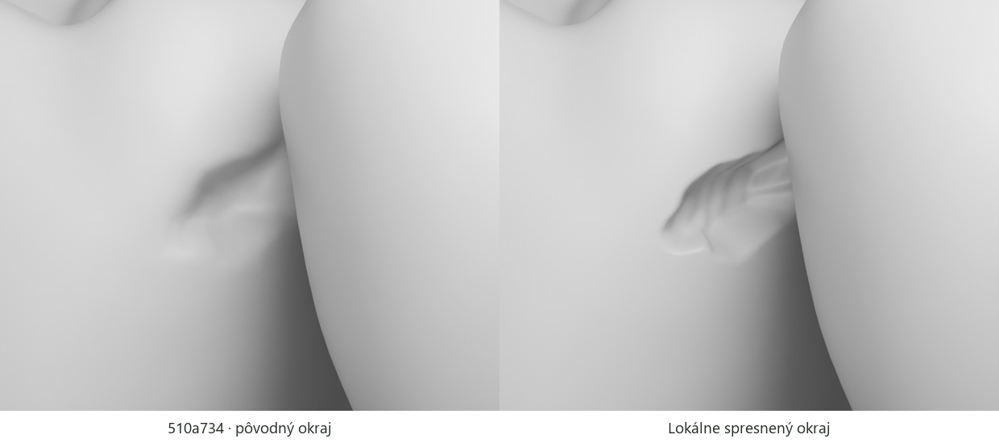

# Geometria príbehu medzi 36 a 37

[Priestor, dráha kefky a plochy povlaku](../public/story-assets/site.json) vychádzajú z naozaj umiestnených zubov 36 a 37. GLB sú v lokálnych metroch, svetová scéna v centimetroch a dĺžky nástroja v milimetroch. Posun dolného oblúka −0,48 cm je už zahrnutý vo svetových hodnotách. Zuby sa pre kefku neodsúvajú. Mierka je ilustračná, nie meranie konkrétneho pacienta.

## Kde prechádza kefka

V najužšej nájdenej oblasti sú tvrdé povrchy vzdialené približne 0,202 mm. Nie je to nulový bod dotyku. Zvolená priama os kefky leží približne **2 mm apikálne** od tejto oblasti a vedie 14,35 mm z bukálnej na lingválnu stranu vrátane voľného začiatku a konca. Kontrola hustých vzoriek oboch úrovní detailu dáva dolnú hranicu vzdialenosti osi od tvrdého povrchu **0,439 mm**. Využíva vlastnosť, že vzdialenosť od povrchu sa medzi dvoma bodmi nemôže zmeniť o viac než ich vzájomná vzdialenosť; od vzorkovaného minima sa odpočítava polovica kroku a numerická rezerva.

Drôt v tejto ilustrácii má priemer **0,18 mm**, teda radiálnu rezervu aspoň 0,349 mm. Voľný vonkajší priemer štetín je 1,2 mm; **pevná trubica tohto priemeru by neprešla**. Ich geometrický dosah zahŕňa iba časť priľahlého povlaku. Hrubá objímka zostáva na vstupnej strane; jej predná osová stanica má limit 1,429 mm od začiatku dráhy, pred prvou dvojicou protiľahlých stien. Údaje o miestnych stenách, najbližších bodoch a normálach sú uložené pri 112 vzorkách dráhy.

**Predvedený maximálny posun špičky je 11,7 mm**, kratší než celý preskúmaný koridor. Pri tejto polohe leží hrana objímky na osovej stanici −1,4 mm, ešte pred vstupom. Rovnaké skrátené rozpätie určuje aj dosah zobrazeného čistenia. Oblasť s intenzívnym počiatočným zvýraznením povlaku je sústredená pri kontaktnej dráhe; jej periféria je od začiatku slabšia a počas čistenia sa plošne nestlmí. Podrobné rozmery a kontroly sú v [opise kefky a povlaku](INTERDENTAL_BRUSH.md).

Tieto čísla nehovoria, kam možno zaviesť kefku v živých ústach: scéna neobsahuje papilu, ďasno, mäkkotkanivový odpor ani silu kontaktu. Farba nástroja nie je univerzálnym odporúčaním jeho veľkosti. [Odborné zdroje a hranice príbehu](DENTAL_STORY_SOURCES.md).

## Čo sa čistí a čo zostáva

Povlak vychádza z trojuholníkov distálnej plochy 36 a meziálnej plochy 37. Na 36 používa v oblasti dutiny rovnaké rozdelenie plôch aj deformáciu ako hostiteľský zub. Kompaktnejší zub 37 má vlastný povrchový výrez. Každý vrchol nesie svoju vzdialenosť od dráhy, najbližšiu osovú stanicu a váhu okraja. Oproti verzii `510a734` pribudol na 36 jemný bukálny výbežok dlhý približne 1,14 mm v smere osi kefky. Jeho 26 nových kladne vážených vzoriek leží mimo voľného polomeru štetín. Najvyššia nová váha je 0,47 pri maxime hlavného povlaku 1. Výbežok preto ostáva súčasťou zvyškového povlaku aj po čistení.

Hypotetická lézia je na distálnej ploche 36, 1,05 mm apikálne a 2,00 mm bukálne od najužšej oblasti. Jej stred leží približne 4,32 mm koronálne od miestneho **odhadnutého** krčkového rozhrania. Na rozdiel od dostupných plôch povlaku je 1,14 mm od osi drôtu — mimo voľného polomeru štetín 0,60 mm. Zobrazená kefka tento stred nedosiahne a nevylieči už vzniknutú dutinu.

## Skorá zmena a skutočná priehlbina

[Lokálne spresnená geometria 36](../public/story-assets/caries-36.json) delí 611 pôvodných trojuholníkov pri distálnej lézii. Každý zo 4 197 doplnených zdravých vrcholov leží na pôvodnej ploche. Jeho UV a normála pochádzajú zo susedných vrcholov. Zvyšných 54 573 trojuholníkov si zachová pôvodné indexy. Zub 46 používa pôvodný zdravý model. V skorom nekavitovanom štádiu má geometrický vplyv nulu. Pri plnej kavitácii sa posúva dovnútra 1 236 vrcholov a riedke dáta obsahujú 1 904 záznamov vrátane normál a materiálu okraja.

Priehlbina má **2,41 × 1,48 mm a hĺbku 0,769 mm** v ilustračnej mierke. Pôdorys je rozpätie vrcholov posunutých o viac než 5 µm v dvoch dotyčnicových smeroch. Oproti verzii `510a734` je šírka menšia o 0,011 mm a výška väčšia o 0,004 mm. Dno má namiesto 59 až 1 267 trojuholníkov, ktorých stred má väčšinový podiel materiálu dna. Medián dĺžky ich hrán klesol z 0,193 na 0,048 mm. Strmšia nepravidelná stena zväčšila ilustračný úbytok tkaniva z 0,783 na 0,936 mm³. Stred lézie aj dráha kefky zostali na pôvodných súradniciach.



Kontrolné rendery Cycles používajú rovnaké neutrálne materiály, pohľad a svetlo. Na pravej snímke je vidieť nepravidelný horný tieň a svetlý dolný okraj. Vo webovom materiáli sa hranica exponovaného tkaniva počíta pre každý fragment v rovnakej miestnej milimetrovej sústave ako geometria. Zub 37 prirodzene zakrýva časť lingválnej strany.

Počas postupného prechodu medzi zdravým a zmeneným povrchom zostávajú všetky trojuholníky dna najmenej 0,809 mm od osi drôtu. Túto dolnú hranicu dáva radiálna projekcia šiestich krajných vrcholov každého trojuholníka. Zahŕňa celú plochu pri každej hodnote geometrického vplyvu. Pre všetkých 2 461 trojuholníkov s aspoň jedným vrcholom posunutým o viac než 5 µm je rovnaká hranica 0,688 mm. Voľný polomer štetín je 0,600 mm.

[Audit spresnenej priehlbiny a kefky](proximal-reframe-review/independent-geometry.json) použil skutočné plochy 28 zubov v polohe čistenia s otvorením 8 mm. V piatich vzorkách deformácie a pri oboch úrovniach detailu našiel nula prienikov v 3 780 dvojiciach zubov. Povrch 36 sa neprevrátil ani neotvoril na UV švoch. V 83 polohách nástroja pri každej úrovni detailu neprechádzali jeho pevné časti ani štetiny cez zuby. Dolná hranica odstupu týchto vzorkovaných nástrojových plôch od dna dutiny bola 0,208 mm.

V kontrolných makropohľadoch zostáva viditeľný najhlbší vrchol. Strmšia stena pri šikmom pohľade zatieňuje časť dna. [Audit kamier](proximal-reframe-review/GEOMETRY-AUDIT.md) uvádza zorné podiely vypočítané z plochy trojuholníkov s viditeľným stredom.

[Samostatná kontrola záverečného úsmevu](proximal-reframe-review/smile-closure.json) zahŕňa celú dráhu priblíženia horného oblúka o 5,8 mm so zrelou dutinou na 36. Na každej úrovni detailu prešlo 196 protiľahlých dvojíc bez prieniku. Pri kontrolnom posune o 6,4 mm sa pretli rezáky 21 a 31. Tieto merania opisujú výučbovú scénu.

[Pôvodný audit verzie `f3257d1`](proximal-story-review/morph-geometry-audit.json) zostáva dostupný pre porovnanie so skoršou, užšou ilustráciou.

## Reprodukcia

`assets/source/proximal-story` obsahuje meranie dráhy a výber viditeľného miesta na pôvodnej sieti, vrátane spustiteľných Blender skriptov. Po prípadnej zmene podkladov treba zopakovať priestorové audity. Bežné zostavenie webu Blender nepotrebuje.

```sh
python scripts/prepare_proximal_story.py
node scripts/validate-proximal-site.mjs
node scripts/test-cleaning-path.mjs
node scripts/audit-brush-contact.mjs
node docs/proximal-reframe-review/run-audit.mjs
blender --background --factory-startup --python-exit-code 1 --python docs/proximal-reframe-review/smile-closure.py
blender --background --factory-startup --python scripts/render_caries_review.py -- ../geometry-review
```

Geometrický pôvod, licencia CC BY 4.0 a opis nových úprav: [kredity príbehu](../public/story-assets/credits.txt).
