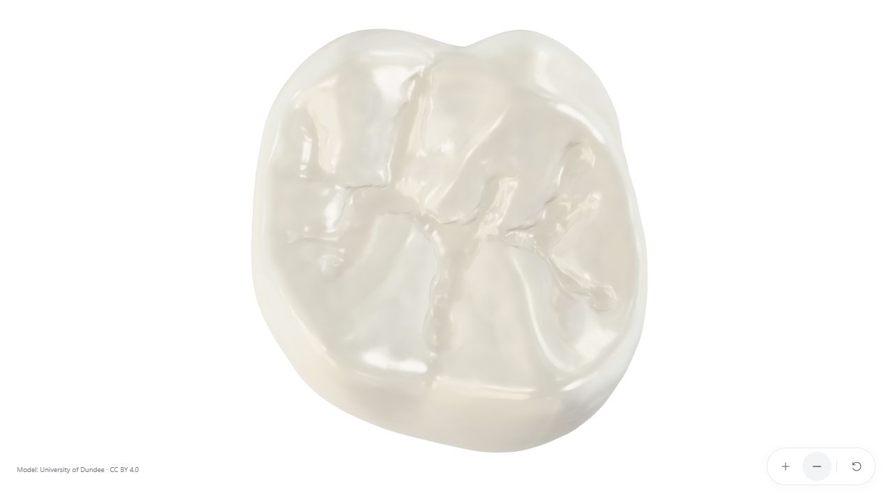

# Overenie modelu a vizuálnej kvality

Kontrola z 11. októbra 2026. Základom je jeden horný ľavý prvý molár Dundee FDI26 s tromi pôvodnými koreňmi. Táto verzia prepracúva vonkajší reliéf, vnútorné optické vrstvy, materiály, svetlá a mobilnú distribúciu. Fotorealizmus na úrovni nerozoznateľnej fotografie sa netvrdí.

## Finálne exporty

| Vlastnosť | Desktop | Mobil |
|---|---:|---:|
| Trojuholníky všetkých vrstiev | 388 032 | 140 692 |
| Veľkosť GLB | 17 573 752 B | 6 869 956 B |
| Enamel / Dentin / Cementum objekty | 2 / 1 / 1 | 2 / 1 / 1 |
| Enamel mapy a normal | 2048 px | 1024 px |
| Koreňové color/roughness mapy | 1024 px | 1024 px |
| Odhad dekódovaných materiálových RGBA textúr s mipmapami | 96 MiB | 32 MiB |
| Refrakčný render, lineárny pomer rozlíšenia | 1,0 | 0,75 |
| Khronos Validator: chyby / varovania | 0 / 0 | 0 / 0 |

Pamäťový odhad zahŕňa materiálové obrázky, **nezahŕňa** render targets, HDR/PMREM, geometriu ani réžiu GPU ovládača. Nie je to meranie celkovej spotreby telefónu. Trojuholníky zahŕňajú aj vnútorné plochy; nie všetky sú naraz viditeľné. Počet kreslených trojuholníkov vo frame navyše zahŕňa refrakčný priechod a prípadnú aktualizáciu tieňov.

## Geometria a export

[Nezávislý audit](review/geometry-audit.json) kontroloval zdroj, obe odvodené siete aj skutočné exportované GLB. Sklovina a dentín sú po spojení rovnakých pozícií uzavreté a konzistentne orientované, bez zistených degenerovaných plôch, otvorených švov alebo prienikov vrstiev. Cementum je otvorený koreňový povrch; spolu s vonkajšou sklovinou tvorí uzavretý obal. Test prienikov vylučuje trojuholníky so spoločným zvareným vrcholom a necertifikuje medicínsku presnosť.

Najväčšia nameraná vzdialenosť kontrolovaných vonkajších vrcholov od pôvodnej siete je 0,1606 mm. Tri vetvy koreňov pod Y = −5 mm zodpovedajú zdroju. Pôvodný BIN zostal nezmenený. Pridané dentínové rozhranie, hrúbka skloviny a krčok sú ilustračné, nie nameraná histológia.

Po audite nasledovala iba oprava normál a tangentov. [Dôkaz](review/normal-seam-fix-proof.json) potvrdzuje rovnaké bajty pozícií, indexov a UV pre každú primitívu. Audit obsahuje aj finálne SHA256 tejto úpravy. Oprava normál odstránila umelé odlesky na UV švoch a oddeľuje zatvárací okraj skloviny od normál viditeľného povrchu. Finálne GLB znovu prešli Khronos validátorom.

## Skutočné vizuálne kontroly

Interaktívny Three.js render bol skontrolovaný v zabudovanom Chromium prehliadači na počítači s RTX3060Ti. Overené bolo načítanie HD a mobilného GLB, shader bez chýb, ovládanie myšou, klávesnicou, zoom a presný reset. WebGL konzola nehlásila chyby ani varovania. Produkčná Vite zostava prešla; JavaScript má približne 898 kB / 271 kB gzip vrátane LTC tabuliek pre plošné osvetlenie. Vite uvádza upozornenie na veľkosť chunku, nie chybu zostavy.

Snímky webového renderu:

- [Predvolený pohľad](review/web-default.jpg)
- [Bočný pohľad](review/web-side.jpg)
- [Zadný pohľad](review/web-back.jpg)
- [Žuvacia plocha pri priblížení](review/web-top.jpg)
- [Mobil 390 × 844](review/web-mobile.jpg)

Portréty 390 × 844 a 360 × 740 aj orientácia 844 × 390 zachovali celý zub v predvolenom pohľade a nepretekali vodorovne. Mobil načítal optimalizovanú verziu. Nastavenia dotykového ovládania používajú OrbitControls: jeden prst otáča, dva prsty približujú/otáčajú. **Fyzický telefón ani dotykové gestá na skutočnom zariadení neboli testované**, preto sa neuvádza mobilné FPS. Diagnostika [desktop](review/desktop-diagnostics.json) / [mobil](review/mobile-diagnostics.json) zachytáva emulovaný viewport. Jej hash assetov pochádza z bežiaceho dev servera; produkčný build vypočíta nový hash z finálnych súborov.

Samostatný Blender Cycles kontrolný render exportovaného modelu preveril [prednú](review/cycles-front.png), [bočnú](review/cycles-side.png), [zadnú](review/cycles-back.png) a [okluzálnu](review/cycles-top.png) stranu. Používa 96 vzoriek, 105 mm kameru a AgX; presné nastavenia sú v [zázname renderu](review/cycles-settings.json). Tieto snímky majú vlastné svetlá; **nie sú screenshotmi webového dema**. Web používa Neutral tone mapping, HDR Studio Small09 a plošné LTC osvetlenie.

## Zostávajúce hranice vzhľadu

Vrstvená optika, jemnejší krčok, lokálne drsnosti a geometrické zatienenie zlepšili odlíšenie skloviny a koreňov. Jasné plochy nestrácajú všetky prechody do čistej bielej. Pri makro priblížení však stále vidno mäkký charakter časti pôvodnej žuvacej rekonštrukcie a výtvarne vytvorenú optiku.

Na ďalší výrazný skok treba jemnejší oprávnene získaný sken hornej šestky, ideálne s nameranou sklovinou/dentínom, a kalibrované fotografie materiálu zdravej vzorky. Perspektívny Melbourne microCT export vyžaduje používateľské prihlásenie na Sketchfab. Zdroj Dundee tieto merané vnútorné vrstvy a fotografické PBR podklady neposkytuje. Dostupný Blender umožnil skutočné modelové úpravy, export a bake; tieto chýbajúce merania však nevytvoril.
