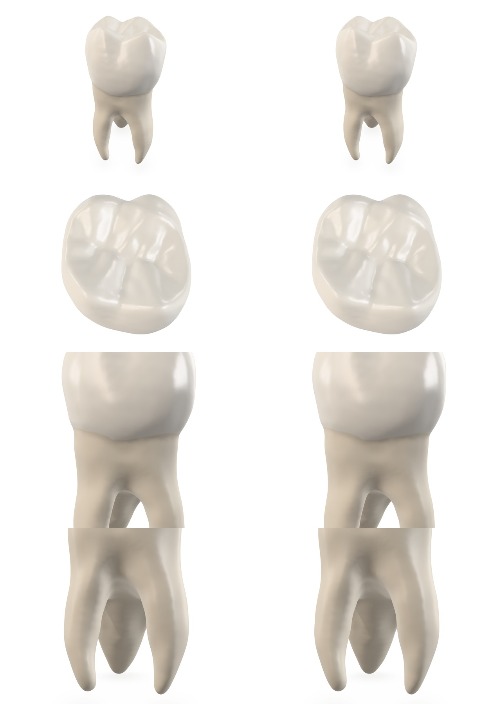

# Jemné doladenie schváleného zuba — 4. november 2026

Používateľ schválil vzhľad prototypu a zvolil ďalšie zdokonaľovanie samotného zuba. Táto úprava sa preto týka iba povrchu v `/prototype/`. Pôvodná hlavná prezentácia ostáva bez zmeny. Záloha schválenej verzie: tag `backup/approved-tooth-2026-11-04`, commit `95202c7`.

## Výsledná úprava

Zachované sú geometria, tri korene, farby, základné drsnosti, IOR, osvetlenie, expozícia, kamera, interakcie aj všetky GLB/textúry. Sklovina zostáva nepriehľadná, `metalness=0`, `opacity=1`, `transmission=0`; nevznikla nová lesklá vrstva.

Zmenil sa výpočet jemného výškového signálu. Predtým jeho derivácia zahŕňala aj filter vypočítaný cez `fwidth` a prechodovú masku. Nový shader derivuje iba pôvodný výškový signál; filtrovanie, amplitúdu a masku aplikuje až na výsledný sklon. [GLSL ES 3.00, §8.9](https://registry.khronos.org/OpenGL/specs/es/3.0/GLSL_ES_Specification_3.00.pdf#page=111) nedefinuje vyššie derivácie. Oprava odstraňuje túto závislosť od správania kompilátora a zabraňuje pridávaniu gradientu samotnej krčkovej masky. **Na testovanom ANGLE/D3D11 samotná oprava vzhľad prakticky nemení; netvrdí sa namerané zlepšenie na všetkých GPU.**

Mikroréliéf skloviny si ponechal pôvodnú hornú hranicu približne 0,252 µm peak-to-peak pri ilustračnej výške 21 mm. Korene majú samostatné, mierne pozdĺžne pretiahnuté nepravidelné bunky s hornou hranicou približne 0,693 µm. Nie sú to periodické prúžky ani nové geometrické ryhy. Dopĺňa ich slabá miestna variácia **drsnosti**, bez farebného šumu: najviac ±0,006 na sklovine a ±0,010 na koreňoch, bunky približne 0,6 mm. Všetky hodnoty sú v `src/prototype/config.js`.

Ide o **autorské materiálové aproximácie**, nie mikroskopické meranie konkrétnej vzorky. Nenahrádzajú anatomické hrbolčeky a fisúry. Zmena je zámerne jemná; nejde o novú anatomickú rekonštrukciu ani zásadný skok vo fotorealizme.

## Čo sa overilo a nepoužilo

Testovaný bodovo-normálový interpolant zachoval pôvodné vrcholy a pridal zaoblené stredy hrán s limitom odchýlky 0,0199 mm. Namiesto 57 008 by mal 228 032 trojuholníkov a desktopový GLB by narástol z 3,51 na 9,69 MB. Na bežnom clay pohľade bol vizuálne nerozlíšiteľný. [Záznam siluety](refinement-2026-11-04/silhouette-study.json) meria integrovanú zmenu pokrytia na jednotku hranice; prehľad bol približne 0,021 px. Toto nie je meranie maximálneho posunu hrany. Kandidát sa **nepublikoval**.

Skutočný WebGL A/B pôvodnej 4K normálovej mapy proti schválenej 2K/1K verzii tiež neukázal materiálny prínos v skúšaných pohľadoch vrátane maximálneho zoomu. P99 maximálneho rozdielu RGB kanálu bolo 1/255; nešlo o znovuzískané anatomické detaily. Desktopová 4K mapa by pritom pridala približne 64 MiB dekódovanej textúrovej pamäte s mipmapami. Preto ostáva **2K desktop / 1K mobil**. [Podrobný A/B záznam](refinement-2026-11-04/normal-resolution-study.json).

## Skutočné porovnanie schváleného a nového shaderu

`scripts/review-surface.mjs` načíta schválený shader a konfiguráciu priamo z commitu `95202c7` a cez vývojový server ich porovná s novým shaderom na rovnakých assetoch, osvetlení, kamere, DPR a výstupe. Test kontroluje, že sa baseline moduly naozaj nahradili; produkčný preview na tento zdrojový A/B nestačí. Tretí variant izoluje len opravu derivácie. Výsledky: [surface-ab.json](refinement-2026-11-04/surface-ab.json).

Vľavo je schválená verzia, vpravo nový povrch. Zhora: celý zub, koruna, krčok, korene. Ide o skutočné WebGL obrazy, nie fotografie ani AI generované obrázky. Zámerne je viditeľné, že bežný vzhľad sa zásadne nemení.

Samotná oprava derivácie dala v bežnom, korunkovom a koreňovom zábere rovnaké RGB pixely; pri krčku bol maximálny rozdiel 1/255. Úplný jemný pass mal v bežnom zábere RGB RMS rozdiel približne 0,21 úrovne z 255; v koreňovom makre približne 0,42. P99 maximálneho kanálového rozdielu bolo v každom zábere 1/255. Preto sa neuvádza výrazná vizuálna zmena ani obnovenie chýbajúceho skenu.

Osem mierne posunutých záberov sa osobitne porovnalo s dvojnásobným WebGL rozlíšením zmenšeným Lanczos3. Najhoršie P99 rozdiely vzorkovania zostali 1–2 úrovne z 255, podobne ako pri schválenej verzii. Je to pomocná kontrola vzorkovania, **nie dôkaz fyzikálne správneho rozptylu alebo fotografia ako ground truth**.

Aktuálne snímky: [celý zub](refinement-2026-11-04/home.png), [žuvacia plocha](refinement-2026-11-04/crown.png), [krčok](refinement-2026-11-04/neck.png), [korene](refinement-2026-11-04/root.png), [mobilný viewport](refinement-2026-11-04/mobile.png).

## Regresia a rozpočet

[Funkčné testy produkčnej zostavy](refinement-2026-11-04/functional-tests.json) prešli: všetky strany zuba, zoom a reset, myš, simulovaný dotyk aj pinch, mobilné portrétové/landscape rozloženie a DPR limit, nečinná render slučka, chybové stavy, zrušenie načítania aj opakovaný dispose. Overená bola tiež pôvodná hlavná stránka. Bežné načítanie nemalo JS/shader chyby ani404; nefatálne D3D11 upozornenie `X4122` je zachované v reporte.

Meranie na RTX3060Ti v samostatnom headless Chrome dalo pri nútenej rotácii medián rAF intervalu približne 16,7 ms. Mobil je **emulovaný viewport na tomto počítači**, nie fyzický telefón ani potvrdenie mobilných FPS. Prepínanie skutočnej viditeľnosti karty tento headless režim neoveril. GLB validácia: 0 chýb / 0 varovaní, kontrolné súčty ostali rovnaké.

Veľkosť, počet trojuholníkov a textúrový rozpočet sa nezvýšili: 3 510 564 B a 2 716 748 B, po 57 008 trojuholníkov; približne 42,7/10,7 MiB materiálových textúr s mipmapami. Shader má ďalší výpočet procedurálneho šumu; reálny výkon na slabšom zariadení treba naďalej overiť na danom hardvéri.

Pôvod/licencie ostávajú rovnaké: Dundee a odvodené modelové mapy **CC BY 4.0**, Studio Small09 **CC0**, nový kód **MIT**. [Kredity](../public/prototype-assets/credits.txt). Ďalší podstatný posun v jemnosti anatomickej žuvacej plochy potrebuje lepší oprávnene získaný podklad; ani hustejšia interpolácia ani zosilnený šum ho nevytvoria.

Spustenie zostáva `pnpm dev`, stránka `/prototype/`. A/B: pri bežiacom Vite dev serveri `node scripts/review-surface.mjs`, s dostupnými modulmi Playwright a Sharp alebo s `PLAYWRIGHT_MODULE_PATH` / `SHARP_MODULE_PATH`. Revíziu zdroja možno určiť `TOOTH_BASELINE_COMMIT`, cieľ mimo repozitára `SURFACE_REVIEW_DIR`. Plné funkčné testy: `node scripts/test-prototype.mjs`.
