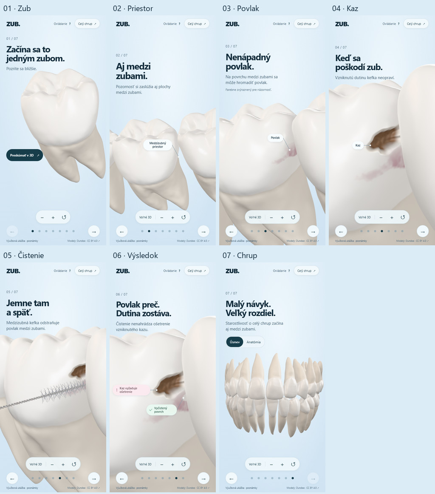

# Spoločná scéna na ľadovomodrom pozadí

Zuby, kefka, nadpisy a anatomické popisky používajú jednu plochu. Priehľadné WebGL plátno vypĺňa celý stage; modré pozadie `#DCECF7` s jemným gradientom je v CSS. Dvojriadkový nadpis je skutočný HTML H1. Počítadlo, sedem navigačných bodiek a šípky reagujú na rovnakú kapitolu ako model.

Táto úprava vychádza z verzie `3f52ac5`. Nemení podkladové GLB, geometriu dutiny, dáta povlaku ani dráhu kefky. Samostatný horný molár na `/prototype/` a historický prehliadač na `/legacy/` zostávajú dostupné. [Príbeh a technická architektúra](DENTAL_STORY.md) · [Historická úprava geometrie a materiálov](VISUAL_POLISH.md).

## Overená zostava a výsledok

Kontrola 9. novembra 2026 na produkčnom náhľade `main-BPz8oJ6Y.js`, CSS `main-Dp-IQlD4.css`, Chrome 156.0.8078.80: **980 z 980 kontrol prešlo**, bez výnimiek JavaScriptu, chýb WebGL alebo siete. Všetkých 40 stavových snímok vzniklo na rovnakom JS bundle. Prehliadač vypísal jedno upozornenie D3D `X4122` o zaokrúhlení nepatrných shaderových konštánt; renderovanie aj kontrola shaderových chýb prešli. [Úplný report](shared-stage-review/browser-report.json).

Sedem hlavných kapitol je zachytených v rozmeroch **1440×900, 390×844 a 360×800**. Doplnkové kontroly pokrývajú aj 320×568, 844×390, fázy kefky a ručné priblíženie. Staršie prekrytie hrbolčeka nadpisom v malom 320px náhľade sa na tejto zostave neopakuje. Samostatná [kontrola čistenia pri 1280×900](shared-stage-review/1280-cleaning.json) nenašla prekrytie textových riadkov žiadnym premietnutým vrcholom zuba 35.

Na počítači aj v dotykovom profile prešlo po 60 nezávislých kontrolách popisiek: pôvod kotvy, pohyb s morphom, projekcia a konce čiar, skrytie po zakrytí, negatívne kontroly mimo záberu aj za kamerou a priechod vstupu cez HTML/SVG. Čisté testy typografie, príbehu, kamery, návratu a ovládania prešli tiež. Diff priečinkov `public/models`, `public/prototype-assets`, `public/dentition-assets` a `public/story-assets` oproti `3f52ac5` je prázdny; report overuje aj jednotlivé chránené SHA-256. Priestorové závery o dutine a dráhe kefky nadväzujú na existujúce audity zhodných dát.

## Skutočné snímky

Nasledujúce JPEG sú kópie pokojových snímok prehliadača; prehľady ich iba zmenšujú a skladajú. Nejde o návrhy alebo generované obrázky. [Metadáta kamery, rozloženia a SHA pôvodných PNG](shared-stage-review/capture.json) · [SHA publikovaných obrázkov](shared-stage-review/images.json).

| Kapitola | 1440×900 | 390×844 | 360×800 |
|---|---|---|---|
| Začína sa to jedným zubom. | [Snímka](shared-stage-review/1440x900-hero.jpg) | [Snímka](shared-stage-review/390x844-hero.jpg) | [Snímka](shared-stage-review/360x800-hero.jpg) |
| Aj medzi zubami. | [Snímka](shared-stage-review/1440x900-space.jpg) | [Snímka](shared-stage-review/390x844-space.jpg) | [Snímka](shared-stage-review/360x800-space.jpg) |
| Nenápadný povlak. | [Snímka](shared-stage-review/1440x900-plaque.jpg) | [Snímka](shared-stage-review/390x844-plaque.jpg) | [Snímka](shared-stage-review/360x800-plaque.jpg) |
| Keď sa poškodí zub. | [Snímka](shared-stage-review/1440x900-caries.jpg) | [Snímka](shared-stage-review/390x844-caries.jpg) | [Snímka](shared-stage-review/360x800-caries.jpg) |
| Jemne tam a späť. | [Snímka](shared-stage-review/1440x900-brush.jpg) | [Snímka](shared-stage-review/390x844-brush.jpg) | [Snímka](shared-stage-review/360x800-brush.jpg) |
| Povlak preč. Dutina zostáva. | [Snímka](shared-stage-review/1440x900-result.jpg) | [Snímka](shared-stage-review/390x844-result.jpg) | [Snímka](shared-stage-review/360x800-result.jpg) |
| Malý návyk. Veľký rozdiel. | [Snímka](shared-stage-review/1440x900-dentition.jpg) | [Snímka](shared-stage-review/390x844-dentition.jpg) | [Snímka](shared-stage-review/360x800-dentition.jpg) |

[Prehľad počítača](shared-stage-review/1440x900-overview.jpg) · [Prehľad 390px](shared-stage-review/390x844-overview.jpg) · [Prehľad 360px](shared-stage-review/360x800-overview.jpg) · [Štyri rovnaké stavy pred/po pri 390×844](shared-stage-review/390x844-comparison.jpg).



## Rozsah kontrol

Prehliadačový test kontroluje skutočné WebGL plátno, nie počet farebných pixelov HTML nadpisu nad ním. Meria celé plátno, projekciu anatomických bodov proti textovým riadkom, ovládanie cez text, dve blokové línie H1, navigáciu, hero CTA a prepínače poslednej kapitoly. Samostatne rekonštruuje kotvy popisiek z živých trojuholníkov vrátane morpha; porovnáva ich projekciu a pomocou nezávislého raycastu overuje skrytie zakrytej kotvy po otočení.

Regresie zahŕňajú oba smery scrollu a priame preskoky, mouse drag, vodorovné dotykové gesto, zvislý scroll, pinch, Voľné 3D, návrat kamery, resize, reduced motion, oneskorené načítanie, chybný údaj o dutine, stratu WebGL kontextu, uvoľnenie zdrojov a načítanie pod prefixom `/zub-3d/`. Všetky uložené zábery jedného behu musia pochádzať z rovnakého produkčného JS bundle.

## Reprodukcia

Po `pnpm build` spustite `pnpm preview`. Nasledujúce skripty vyžadujú lokálne nainštalovaný Playwright a Chrome:

```sh
node scripts/test-stage-typography.mjs
node scripts/test-dental-story-browser.mjs
node scripts/capture-shared-stage.mjs ../professional-review/ice-blue-storyboard-2026-11-09/after
```

`PLAYWRIGHT_MODULE_PATH` umožňuje zvoliť dostupný modul Playwright; `DENTAL_STORY_TEST_URL` iba lokálny preview. `DENTAL_STORY_REVIEW_DIR` mení umiestnenie reportu. Capture skript štandardne používa 1440×900, 390×844 a 360×800; voliteľné `DENTAL_STORY_CAPTURE_SIZES` prijíma rovnaký zápis oddelený čiarkami. Snímky vznikajú až po návrate plného pokojového DPR, bez nastavovania kamery testom. `scripts/test-experience.mjs` je kompatibilný vstup do aktuálnej sady.

Mobilné rozmery a dotyk emuluje Chrome na desktopovom GPU. Nejde o skúšku fyzického iPhonu, mobilného Safari ani meranie telefónneho FPS. V závere zostávajú viditeľné prirodzené korene; mäkké tkanivá nie sú súčasťou modelu. Makro ukazuje výrez troch zubov a rukoväť kefky či časť okolitých zubov presahuje okraj obrazu. Vizuálna a technická kontrola nepredstavuje klinickú validáciu ilustrácie.
